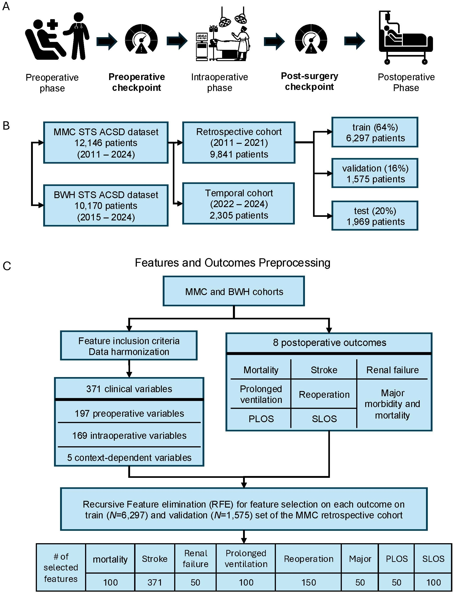
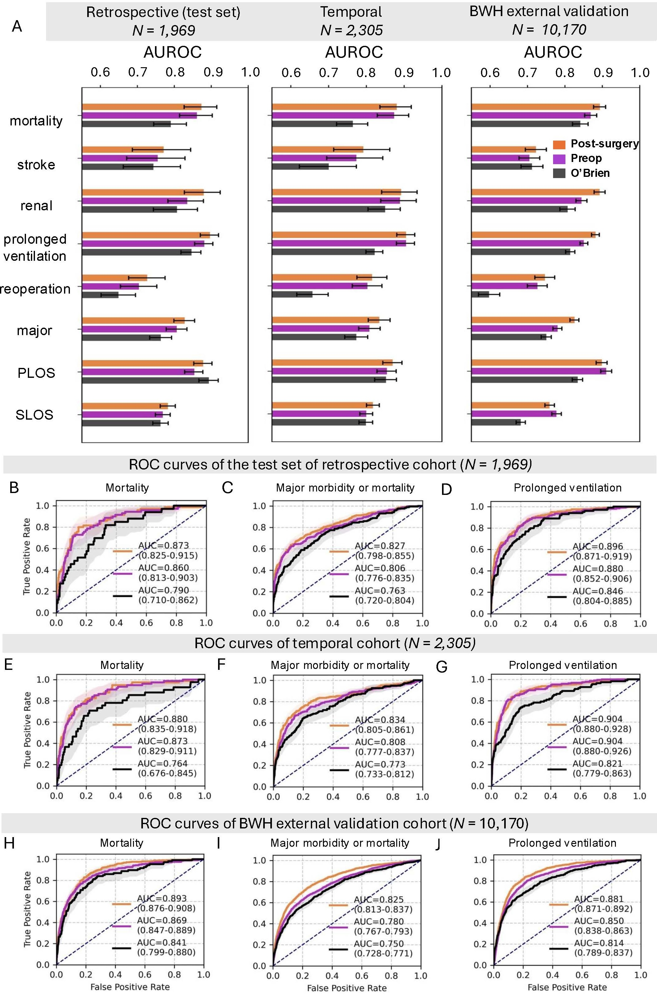

# STEP-Risk: A Multicenter Risk Prediction Framework for Cardiac Surgery Patients

This repository contains the **processing, modeling, and figure-generation code** for the study:

> **STEP-Risk: A Multicenter Risk Prediction Framework for Cardiac Surgery Patients**
> Qingchu Jin, Saeed Amal, Jaime B. Rabb, Felistas Mazhude, Venkatesh Shivandi, Negin Maddah, Amin Ramezani, et al.

**STEP-Risk** (*Sequential Timepoint Estimation of Patient Risk*) is an explainable, machine-learning–based **multi-checkpoint** framework that estimates the risk of eight major postoperative outcomes in cardiac surgery patients at two clinically relevant checkpoints:

- a **preoperative checkpoint** for baseline risk assessment, and
- a **post-surgery checkpoint** for early postoperative risk re-evaluation (incorporating intraoperative variables).

The framework predicts eight outcomes — **mortality, stroke, renal failure, prolonged ventilation, reoperation, major morbidity or mortality, prolonged length of stay (PLOS), and short length of stay (SLOS)** — each with a dedicated Random Forest model. It was developed on a retrospective cohort from Maine Medical Center (MMC), and validated on an MMC temporal cohort and an external cohort from Brigham and Women's Hospital (BWH).



**Figure 1. Framework and study overview.** (A) The two prediction checkpoints along the surgical timeline. (B) Cohort construction and the retrospective train/validation/test split. (C) Feature and outcome preprocessing, and the number of features selected per outcome via recursive feature elimination (RFE).

---

## ⚠️ Data availability

**The underlying patient-level data cannot be shared.** This repository contains **only code**. The raw and processed clinical datasets — derived from the STS Adult Cardiac Surgery Database (ACSD) records of MMC and BWH — are protected under institutional data-use agreements and are **not included**. This was a multi-center retrospective cohort study using de-identified data, and was determined to be non-human-subjects research by the institutional review boards.

As a result:

- The scripts and notebooks here **cannot be re-run end-to-end** without the underlying data.
- All input data paths have been replaced with **placeholder paths** (e.g. `data/processed/...`, `results/...`) that describe the *expected* file, not a real file.
- The Jupyter notebooks are provided **with their saved outputs (figures and tables) intact**, so reviewers and readers can inspect the exact results and figures reported in the manuscript **without needing the raw data**.

This repository is intended for **transparency and methodological review**, not for reproduction on the original cohorts.

---

## Repository structure

```
STEP-Risk-models/
├── README.md
├── LICENSE
├── requirements.txt
├── .gitignore
│
├── src/                              # Model training / analysis scripts (Python)
│   ├── 01_feature_selection_rfe.py   # Recursive feature elimination (RFE) per outcome
│   ├── 02_postsurgery_model.py       # Post-surgery checkpoint RF models + evaluation
│   └── 03_preop_model.py             # Preoperative checkpoint RF models + evaluation
│
├── notebooks/                        # Figure-generation notebooks (outputs preserved)
│   ├── Figure2_discrimination_summary.ipynb   # AUROC / ROC discrimination results
│   ├── Figure3_calibration_postsurgery.ipynb  # Calibration, post-surgery checkpoint
│   ├── Figure4_feature_importance_shap.ipynb  # SHAP feature-importance analysis
│   └── FigureS3_calibration_preop.ipynb       # Calibration, preoperative checkpoint
│
└── figures/                          # Manuscript figures
    ├── figure1_framework_overview.jpeg
    └── figure2_model_performance.jpeg
```

---

## Code overview

### `src/` — modeling scripts

| Script | Purpose |
|---|---|
| `01_feature_selection_rfe.py` | Trains Random Forest models per outcome and performs **recursive feature elimination** (MDI-based ranking, 30 seeds) to determine how many features each outcome needs. Produces the RFE AUROC curves. |
| `02_postsurgery_model.py` | Selects the top-*N* features per outcome, trains the **post-surgery checkpoint** RF models (with hyperparameter search), and evaluates them on the internal test, temporal, and external (BWH) cohorts. |
| `03_preop_model.py` | Restricts features to **preoperative / mixed** variables, trains the **preoperative checkpoint** RF models, and evaluates them across the same three cohorts. |

> These scripts import a helper module (`code_CTICU.MLfcn`) containing shared training/evaluation functions, and read from an ML-ready processed-data folder. Neither the helper module's data nor the processed data are distributed here.

### `notebooks/` — figure generation

The notebooks reproduce the manuscript figures **from precomputed model outputs** (saved probabilities, SHAP values). Their input paths are placeholders; their **saved cell outputs are the actual published figures and tables**.

| Notebook | Manuscript figure |
|---|---|
| `Figure2_discrimination_summary.ipynb` | Fig. 2 — discrimination (AUROC bars + ROC curves) across cohorts and checkpoints |
| `Figure3_calibration_postsurgery.ipynb` | Fig. 3 — calibration of the post-surgery checkpoint |
| `Figure4_feature_importance_shap.ipynb` | Fig. 4 — SHAP feature importance for major morbidity or mortality |
| `FigureS3_calibration_preop.ipynb` | Fig. S3 — calibration of the preoperative checkpoint |

---

## Model performance



**Figure 2. Discrimination performance.** (A) AUROC across the eight outcomes for the post-surgery checkpoint (orange), preoperative checkpoint (purple), and the O'Brien / STS baseline (black), in the retrospective test set (N = 1,969), temporal cohort (N = 2,305), and BWH external validation cohort (N = 10,170). (B–J) ROC curves for mortality, major morbidity or mortality, and prolonged ventilation in each cohort. At the post-surgery checkpoint, mortality reached AUROC 0.873 / 0.880 / 0.893 across the three cohorts.

---

## Expected data layout (not provided)

If the protected data were available, the scripts and notebooks would expect files under placeholder roots such as:

```
data/processed/     # ML-ready feature/outcome matrices per cohort (X/Y, train/val/test, temporal, external)
results/            # precomputed model objects, predicted probabilities, and SHAP values
outputs/            # destination for regenerated figures/tables
```

These directories are intentionally **absent** from the repository.

---

## Environment

Core dependencies are listed in [`requirements.txt`](requirements.txt) (Python 3, scikit-learn, pandas, numpy, matplotlib, shap, scipy, openpyxl). Install with:

```bash
pip install -r requirements.txt
```

---

## Citation

If you refer to this work, please cite the STEP-Risk manuscript. A `CITATION.cff` will be added upon publication.

## License

This code is released under the **PolyForm Noncommercial License 1.0.0** — see [`LICENSE`](LICENSE). It is free to use for any **noncommercial purpose**, including academic research, teaching, and use by nonprofit, educational, research, and government organizations. **Commercial use requires a separate license** — please contact the corresponding author to arrange one.

This license applies to the **code only**; it does not grant any rights to the underlying clinical data.
